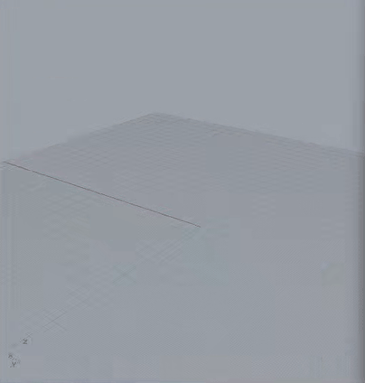
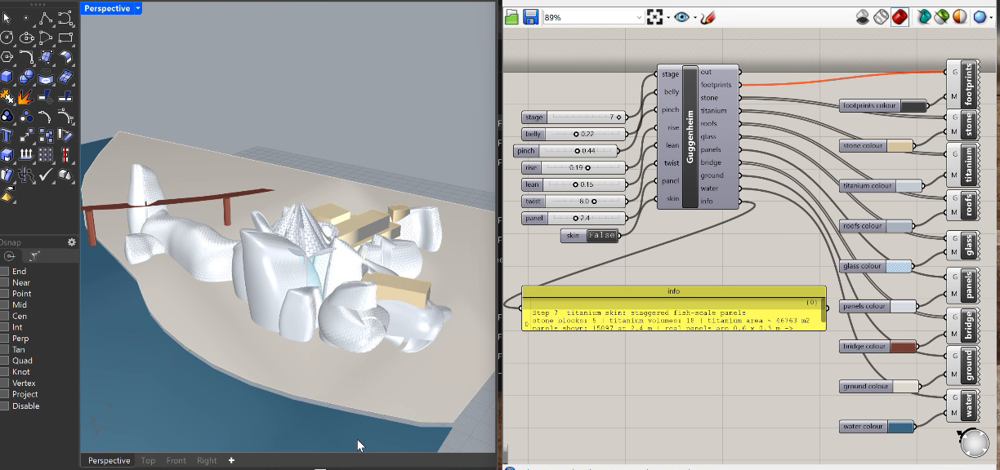

# Parametric Guggenheim Bilbao

**Can a building that was never parametric be described by one rule?**

The Guggenheim Museum Bilbao was shaped by hand with physical models and digitised afterwards. This project tries the opposite: start from open data, write one rule, and see how close it gets.





## How it works

1. **Real input.** Footprints and storey counts for all 20 building parts, the La Salve bridge and the river edge come from OpenStreetMap ([`data/osm_raw.txt`](data/osm_raw.txt), in decimetres, local frame). Heights use 4 m per storey.
2. **One test sorts the parts.** If at least 70% of a footprint's perimeter runs along two perpendicular axes, the part becomes a **limestone block** (an extrusion). Otherwise it becomes a **titanium sail**.
3. **One rule makes every sail.** Each free-form footprint is smoothed and stacked into sections in its own long-axis frame:

   | Parameter | What it does |
   |---|---|
   | `belly` | the side facing away from the atrium bulges out, most at mid-height |
   | `pinch` | the width closes towards the top, ending in a ridge instead of a dome |
   | `rise` | the ridge climbs towards one end, like a sail tip |
   | `lean` | the whole volume leans away from the atrium, like a petal |
   | `twist` | sections rotate slightly with height |

   A small seeded variation per volume stops them looking identical.
4. **Set pieces.** Gallery 104 runs under the bridge as an upturned hull and ends in the tower. The atrium is a flower of petals with glass facing the river.
5. **Skin.** An optional staggered fish-scale panel mesh covers every titanium face (about 15,600 panels at 2.4 m). Panel size is a parameter. The real panels are 0.6 × 0.3 m.

The `stage` input (0 to 7) builds the museum up in order: site, bridge, stone, sails, gallery and tower, atrium, skin. Geometry is cached, so moving `stage` is instant. Only the rule sliders trigger a rebuild.

## Run it

**Rhino 8 + Grasshopper (Python 3 components)**

- **One step:** open Grasshopper, then in Rhino run
  `_-RunPythonScript "<repo>/grasshopper/setup_gh.py"`
  It builds the whole definition: the component, sliders, toggle, coloured previews and the info panel. Then run `layout.py` for a side-by-side recording layout and `orbit.py` for a 360° turntable.
- **By hand:** drop a *Python 3 Script* component, paste [`grasshopper/gugg_bilbao_gh.py`](grasshopper/gugg_bilbao_gh.py), and add:
  - inputs: `stage belly pinch rise lean twist panel skin`
  - outputs: `footprints stone titanium roofs glass panels bridge ground water info`
- **Without Grasshopper:** run the same file with `_-RunPythonScript`. It bakes everything to `Guggenheim::*` layers.

**No Rhino.** The geometry core is plain Python:

```bash
pip install pytest matplotlib
pytest -q                                  # core + mocked-RhinoCommon smoke tests
python tools/preview.py preview.png '{"pinch": 0.45, "rise": 0.2}'
```

## Repository layout

```
src/core.py              geometry rules, pure Python (parse, classify, sail sections, gallery, petals)
src/rhino_layer.py       RhinoCommon layer: lofts, caps, panels, stages, cache, bake fallback
src/header.py            docstring of the Grasshopper script
data/osm_raw.txt         OpenStreetMap extract (ODbL)
grasshopper/             the assembled script + setup / layout / orbit helpers
tools/build_gh_script.py assembles grasshopper/gugg_bilbao_gh.py from src + data
tools/preview.py         matplotlib preview of the core
tests/                   pytest suite (runs in CI)
```

After editing `src/` or `data/`, run `python tools/build_gh_script.py`. A test fails if the assembled file is out of date.

## What it gets right and wrong

The plan reads as Bilbao almost immediately. The silhouette is where a rule ends and a designer's hand begins. With the default values the sails come out spikier than Gehry's; lowering `rise` and `pinch` brings them closer, but some of what makes the building unique doesn't reduce to one rule. Heights are estimated from storey counts, the tower and bridge deck heights are estimates, and this is a study model, not a survey.

## Credits

Data © [OpenStreetMap](https://www.openstreetmap.org/copyright) contributors, ODbL. Code MIT © Kian Shafiei. The Guggenheim Museum Bilbao was designed by Frank Gehry; this is an independent study with no affiliation.
